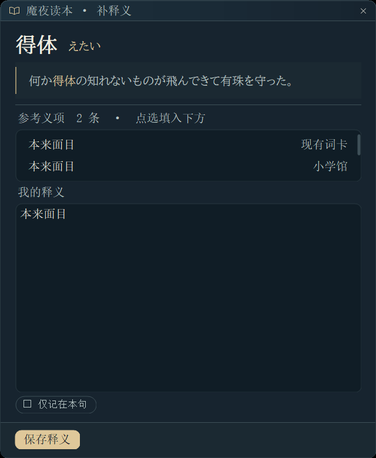

# 魔夜读本 · Mahoyo Yomibito

在 Windows Steam 版《魔法使之夜》里读日语。日文沿用游戏的排版与翻页节奏，澄空中文以小字随行；也可以先读日文，悬浮 1 秒看本句中文，并把喜欢的句子和词语收藏起来。全游戏版使用全部 **24,134 个文本键**，范围包括本篇和番外。剧情中的留白与相同的无注释标题沿用原作。

## 安装

从本仓库的发行版（Releases）下载 `魔夜读本-Windows全游戏版.zip` 并完整解压。退出游戏，打开「魔夜读本安装器.exe」，选择游戏目录并点击「安装读本」。从 Steam 启动游戏，在设置里选择「日本語」。读本支持 Steam Windows x64 Build 13060638。

小学馆《中日・日中統合辞書》随读本安装，点「补释义」即可离线查词。压缩包的「可选词典」目录里另有 Tomoshi 日中词典，可在「悬浮球 → 离线词典 → 导入词典」中添加。

同一个安装器也可以重装和卸载；学习记录会保留。完整操作见[玩家指南](docs/player-guide.md)，发布包的 SHA-256 和测试结果见[公开发布核验](verification/release-20261120/公开发布核验.md)。

## 阅读与学习

- **顺读**　中文跟随日文行首，余宽充足时向右收约半个小字，遇到作者注音或傍点，整词越过注音后续排。前文的译文和描边一同淡去，回指旧句可以看清对应的译文。遇到无法在原布局中容纳中文的演出，独立译文卡保留原来的日文行框。
- **查词**　日文正文中的汉字词都可悬浮看假名。普通词停留约 0.4 秒出现读音。作者注音沿用原作位置。完整词卡在假名上方用金线标出主音调，末端的小圆表示后接助词的音高。N1 词卡可直接悬浮查阅，N2 完整词卡可在设置中开启。作品专用词和易误解的词可附释义。词卡给行间中文和原作注音留出空间，底栏可直接补释义、记词或调整词界。
- **阅读入口**　点击画面右侧的书形悬浮球，切换「对照」或「原文」。「对照」常显中文，「原文」停留 1 秒显示本句译文。「对照」中，把鼠标移到日文上停留约 0.25 秒，画面只保留对应中文。有可靠分句对应时会细到该分句，其余情况显示整句译文。移到正文外就恢复整页中文。拖动悬浮球可调整位置，重开后仍在原处。
- **最近查过**　词卡或读音气泡显示满 0.8 秒，词就进入读本的「最近查过」。读完一段再挑词加入生词本，最多保留最近 500 条。
- **生词本**　碰到只有读音的词，点「补释义」，从离线词典选义或手写。保存后，在剧情里再次遇到这个词，悬浮就能看自己的释义。纯假名词用悬浮球的「点词取词」选取。完整活用会显示辞书形，词卡里的「调整词界」可把复合词或短语一起收入。
- **收藏夹与导出**　点行尾书签保存整句。在「收藏夹」里可写批注、搜索笔记，或把日中原句和批注一起导出。生词本、收藏夹、最近查过都支持 UTF-8 CSV 和 TSV。
- **备份与设置**　关闭游戏后，备份 `mahoyo-learning/` 下的 `settings.ini`、`favorites.tsv`、`personal-words.dat`、`recent-lookups.tsv` 和 `sentence-notes.tsv`。迁移到同版读本时放回同名目录。`[study]` 中的 `record_lookups` 和 `parallel_highlight` 默认开启，设为 0 可分别关闭记录或对应高亮。`ui_japanese_face` 可指定已安装的日文字体。

## 开发与来源

从源码构建、运行测试和复建数据的方法见[开发说明](DEVELOPMENT.md)。

程序在本机运行。日文来自 Steam 完整文本表，译文来自澄空汉化的 Steam 移植，N1/N2 学习词条取自 egg rolls《JLPT N1–N5 一万词》的 Anki 牌组。构建时核对三份输入的哈希，用 Sudachi 确定词边界，保护作品专名，区分原作注音与傍点。二进制中保留了每条原文、对应译文和词条的 UTF-16 字符范围。

项目负责人已确认剧情原文、澄空译文、Anki 词条和小学馆辞书可随《魔夜读本》公开分发。自写代码采用 MIT，各项素材、依赖和字体保留各自版权及许可。详见[来源说明](license-research.md)。
